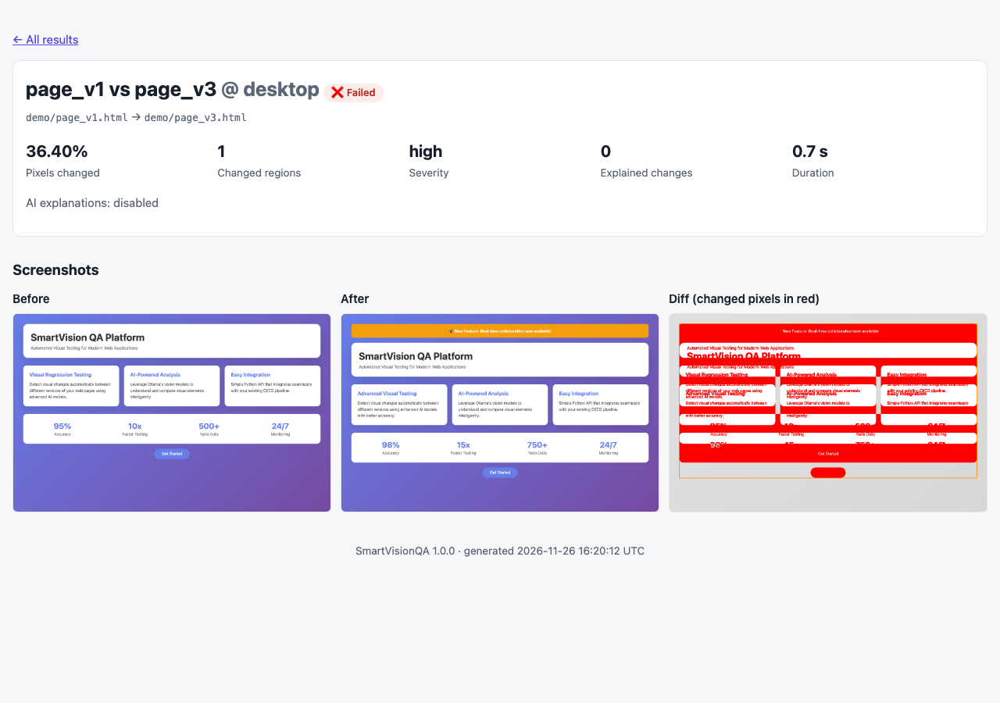

# SmartVisionQA

[](https://github.com/gonzaloMorenoc/smartVisionQA/actions/workflows/ci.yml)


**Hybrid visual regression testing**: a deterministic pixel diff decides *whether* a page
changed, and a local vision model (via [Ollama](https://ollama.com)) explains *what* changed,
region by region. No screenshots ever leave your machine.

```
capture (Playwright) ──► pixel diff ──► changed regions ──► vision model (per region) ──► reports
   deterministic          pass/fail       cropped pairs       structured JSON           HTML · JUnit · MD
```

## Why hybrid?

A vision model on its own is a poor test oracle: it is non-deterministic, it hallucinates
differences on identical pages and misses real ones. SmartVisionQA never lets the model
decide pass/fail:

| Concern | How it is handled |
| --- | --- |
| Is there a regression? | Pixel diff with colour threshold, noise filter and tolerance ratio. Identical pages never reach the model. |
| Where? | Changed pixels are clustered into regions (bounding boxes). |
| What changed? | Each region is cropped from *before* and *after* and sent as two separate images. The model answers with a strict JSON schema (Ollama structured outputs), `temperature: 0` and a fixed `seed`. |
| Bad model output | Schema validation, retries, and a filter that drops "changes" that say nothing changed (e.g. *"V1 has 98%, V2 has 98%"*). |
| Model offline | Run continues with pixel results; the report says the AI was unavailable. |
| How good is the model? | `smartvisionqa evaluate` applies known mutations and reports detection recall, false-positive rate and per-category precision/recall/F1. |

## Quick start

```bash
python -m venv .venv && source .venv/bin/activate
pip install -e ".[dev]"
python -m playwright install chromium

# Pixel-only (no AI needed)
smartvisionqa compare demo/page_v1.html demo/page_v3.html --no-ai

# With explanations (needs Ollama running)
ollama pull qwen2.5vl:7b
smartvisionqa compare demo/page_v1.html https://example.com --viewport 390x844 --viewport 1280x800
```

Open `results/index.html` for the dashboard. Every comparison gets its own folder with
`before.png`, `after.png`, `diff.png`, `result.json` and `report.html`.



## Commands

| Command | What it does |
| --- | --- |
| `smartvisionqa run --config smartvisionqa.yaml` | Runs every `page` (vs. its baseline) and `comparison` (before vs. after) in the config, for every viewport. |
| `smartvisionqa run --update-baselines` | Approves the current screenshots as the new baselines. |
| `smartvisionqa compare BEFORE AFTER` | Ad-hoc comparison of two files or URLs (`--viewport`, `--mask`, `--name`). |
| `smartvisionqa evaluate` | Scores the pipeline and the model on controlled mutations of `demo/page_v1.html`. |

Common flags: `--no-ai`, `--model` (or `$SVQA_MODEL`), `--output`, `--config`, `--log-level`.
Without `--config`, `./smartvisionqa.yaml` is used for settings when present.

**Exit codes** — `0` all checks passed · `1` visual regression, missing baseline or evaluation
threshold missed · `2` configuration, capture or runtime error. Use them directly as a CI gate.

## Baseline workflow (golden images)

```bash
smartvisionqa run --config examples/baseline-mode.yaml                     # 1st run: missing baseline → exit 1
smartvisionqa run --config examples/baseline-mode.yaml --update-baselines  # review & approve
git add baselines/ && git commit -m "test: approve visual baselines"
smartvisionqa run --config examples/baseline-mode.yaml                     # later runs: 0 or 1
```

Generate baselines in the same environment that runs CI (Docker or the CI runner): font
rendering differs between operating systems.

## Configuration

See [`smartvisionqa.yaml`](smartvisionqa.yaml) (demo) and
[docs/configuration.md](docs/configuration.md) for every option: viewports, masks, waits,
diff thresholds and model settings. The config is validated on load and unknown keys are
rejected with a clear message.

## Reports

- `results/index.html` – dashboard of all checks.
- `results/**/report.html` – screenshots, diff overlay and explained changes per region
  (rendered with Jinja2 autoescape and a strict Content-Security-Policy).
- `results/junit.xml` – test results for any CI.
- `results/summary.md` – Markdown table; automatically appended to the GitHub job summary.
- `results/summary.json` – machine-readable results.

## Docker

```bash
docker compose run --rm --user "$(id -u):$(id -g)" smartvisionqa            # demo with Ollama service
docker compose run --rm smartvisionqa compare demo/page_v1.html demo/page_v2.html --no-ai
SVQA_MODEL=qwen2.5vl:3b docker compose run --rm smartvisionqa               # smaller model
```

The image is based on the official Playwright image, runs as a non-root user and exits with
the run's exit code.

## CI/CD

- **`ci.yml`** (every push / PR): ruff, mypy `--strict`, bandit, pip-audit, tests on
  Python 3.10/3.12/3.13 with a real Chromium and an 80 % coverage gate, pixel-engine
  evaluation (100 % detection, 0 false positives), hadolint, actionlint and a Docker smoke test.
- **`visual-qa.yml`** (manual / weekly): runs the demo with a real model, evaluates the model
  and publishes the reports to GitHub Pages.

## Development

```bash
pip install -e ".[dev]" && pre-commit install
pytest                 # unit + integration (real Chromium) + e2e, coverage gate
pytest -m ai           # also talk to a running Ollama server
ruff check src tests && ruff format --check src tests && mypy
```

Architecture notes: [docs/architecture.md](docs/architecture.md) ·
Contributing: [CONTRIBUTING.md](CONTRIBUTING.md) · Changes: [CHANGELOG.md](CHANGELOG.md)

## License

MIT
